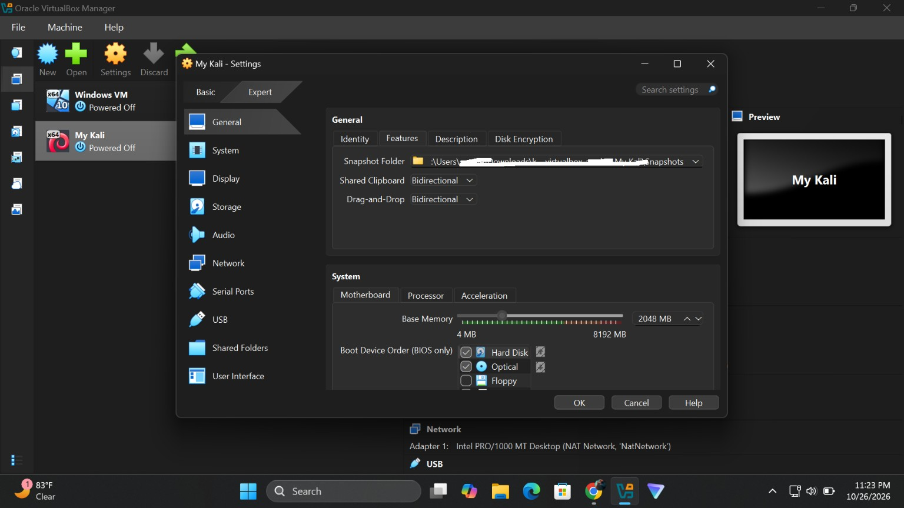
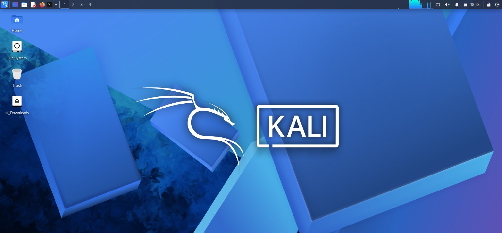

# 🔐 Cybersecurity Lab Setup

### Networkwalks · Week 1 Project

**Building a virtual lab environment with VirtualBox and Kali Linux**

`CYBERSECURITY` · `VIRTUALIZATION` · `LINUX` · `NETWORKING`
:::

------------------------------------------------------------------------

## Project Overview

This project documents the setup and initial verification of a virtual
cybersecurity lab using **Oracle VirtualBox** and **Kali Linux**.

The goal was to prepare a dedicated virtual network and configure Kali
Linux so it can be used for future cybersecurity learning and authorized
penetration-testing exercises. The setup provides a controlled
environment that can be extended with additional virtual machines when
needed.

## Objectives

-   Prepare a Kali Linux virtual machine in VirtualBox.
-   Create a dedicated VirtualBox NAT Network.
-   Connect the Kali VM to the configured NAT Network.
-   Configure and inspect the Kali machine's IPv4 settings.
-   Test connectivity to the virtual gateway, an external IP address,
    and a domain name.
-   Keep a clean recovery point for the virtual machine.
-   Record the configuration and verification evidence.

## Lab Environment

  Component                 Configuration
  ------------------------- ---------------------------
  ```text
  Host operating system     Windows 11
  Virtualization platform   Oracle VirtualBox
  Guest operating system    Kali Linux
  Virtual machine name      My Kali
  Allocated memory          2048 MB
  Virtual network mode      NAT Network
  NAT Network name          NatNetwork
  IPv4 network prefix       10.0.0.0/24
  Kali IPv4 address         10.0.0.2/24
  Default gateway           10.0.0.1
  DNS server                1.1.1.1
  Network adapter           Intel PRO/1000 MT Desktop\
  Promiscuous mode          Deny
  ```

> **Addressing note:** DHCP is enabled on the VirtualBox NAT Network.
> The Kali guest was configured with the static IPv4 settings shown
> above.

## Lab Network Configuration

### 1. Create the VirtualBox NAT Network

A NAT Network named `NatNetwork` was configured in VirtualBox with the
following settings:

-   **IPv4 prefix:** `10.0.0.0/24`
-   **DHCP server:** Enabled
-   **IPv6:** Disabled

A NAT Network allows connected virtual machines to communicate with one
another while providing outbound network connectivity through network
address translation.


### 2. Configure the Kali Linux virtual machine

The Kali virtual machine's first network adapter was connected to the
newly created NAT Network.

  Adapter setting    Value
  ------------------ ---------------------------
  Network adapter    Enabled
  Attached to        NAT Network
  Network name       `NatNetwork`
  Adapter type       Intel PRO/1000 MT Desktop
  Promiscuous mode   Deny
  Cable connected    Enabled


The virtual machine was allocated **2048 MB of RAM**.



### 3. Configure the Kali IPv4 settings

The Kali network connection was configured manually with the following
values:

``` text
Address:  10.0.0.2
Netmask:  24
Gateway:  10.0.0.1
DNS:      1.1.1.1
```

The screenshot below records the IPv4 settings applied to the
`Wired connection 1` connection.


## Verification

After configuring the network, connectivity was checked from the Kali
terminal.

### Commands used

``` bash
ping -c 4 10.0.0.1
ping -c 4 1.1.1.1
ping -c 4 google.com
```

### Results

  Test                                         Result
  -------------------------------------------- ------------
  Reach the NAT Network gateway (`10.0.0.1`)   Successful
  Reach an external IP (`1.1.1.1`)             Successful
  Resolve and reach `google.com`               Successful
  Packet loss shown in the captured tests      0%

The captured terminal output shows **4 packets transmitted, 4 received,
and 0% packet loss** for each of the three tests. The successful domain
test also confirms that DNS resolution was working during the test.




## Recovery Point

A clean virtual-machine snapshot was retained as a baseline recovery
point for the lab. A baseline snapshot makes it possible to return to a
known starting configuration before or after future experiments.

## Challenges and Troubleshooting

No troubleshooting issues were encountered during this setup. The
network configuration and connectivity checks completed successfully.

## Key Takeaways

This exercise provided practical experience with:

-   Creating and configuring a NAT Network in VirtualBox.
-   Connecting a Kali Linux VM to a specific virtual network.
-   Understanding the relationship between a guest IP address, subnet,
    gateway, and DNS server.
-   Applying manual IPv4 settings in Kali Linux.
-   Using `ping` to check gateway and external connectivity.
-   Checking that a domain name resolves and can be reached.
-   Keeping technical work organised with screenshots and written
    documentation.

## Conclusion

The Week 1 lab setup established a working Kali Linux environment on a
dedicated VirtualBox NAT Network. The VM was configured with the
`10.0.0.2/24` address, `10.0.0.1` gateway, and `1.1.1.1` DNS server. The
connectivity checks to the gateway, an external IP address, and
`google.com` all completed successfully with no packet loss in the
captured tests.

This lab will serve as a foundation for future practical cybersecurity
exercises.

## Responsible Use

This environment is intended for learning and authorized security
testing only. Test only systems you own or have explicit permission to
assess.

## Tools and Resources

-   [Oracle VirtualBox](https://www.virtualbox.org/)
-   [Kali Linux](https://www.kali.org/)

------------------------------------------------------------------------

**Author:** Shedrack odufalu\
**Program:** Networkwalks Cybersecurity Internship\
**Project:** Week 1 --- Cybersecurity & Pentesting Lab Setup
